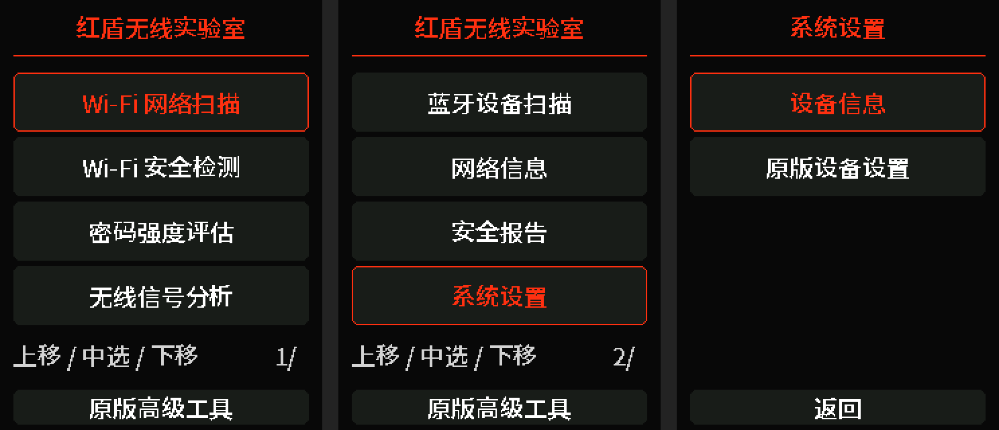
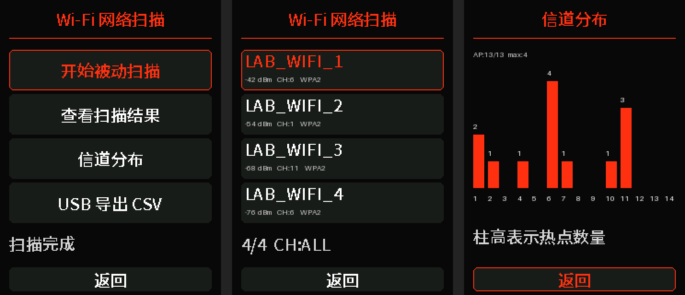
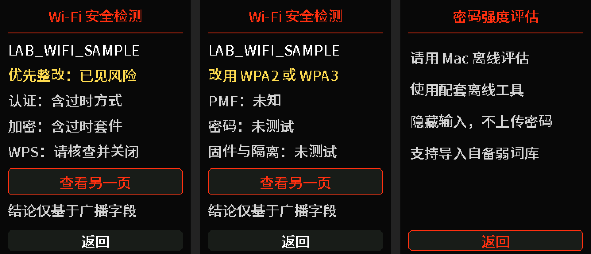
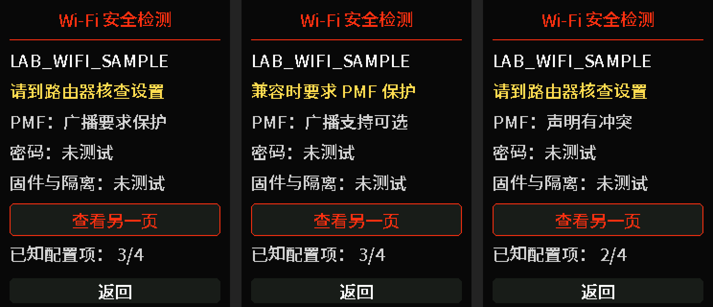

# RedGuard WiFi Lab · 红盾无线实验室

基于 [ESP32 Marauder](https://github.com/justcallmekoko/ESP32Marauder) 的个人无线安全研究项目，面向 **ESP32-2432S028R 双 USB CYD**。保留上游驱动和高级工具，提供中文竖屏界面、轻量启动画面、被动热点分析与 Mac 离线密码评估。

> 当前为开发预览版：已做本地编译和逻辑测试，新增固件尚未刷入开发板验证。功能发现的是可观察配置和异常线索，不能保证发现全部漏洞。









以上是桌面生成的布局预览，扫描数字和名称为模拟数据，不是设备截图。

## 支持的硬件

- 本项目配置：双 USB CYD，ESP32、4 MB Flash、**ST7789** 屏幕、XPT2046 触摸。
- 屏幕方向：**240×320 竖屏**。
- 无线频段：2.4 GHz；不支持 5 GHz / 6 GHz 扫描。
- 不要求 PSRAM、SD 或电池检测模块。没有电池检测硬件，不显示虚构电量。
- 外观相似的单 USB CYD 可能使用不同显示驱动，不能直接套用本固件。

## 当前功能

| 功能 | 状态 |
| --- | --- |
| 中文首页、分页、系统信息 | 已实现，待新固件实机回归 |
| 红盾启动画面、中文初始化进度 | 已实现，待实机验证 |
| 原版触控方式与高级工具入口 | 保留；原版深层界面仍以英文为主 |
| 异步被动 Wi-Fi 扫描、手动停止/刷新 | 已实现，待实机验证 |
| 最多 64 个热点、BSSID 去重、RSSI 排序 | 已实现并有逻辑测试 |
| 信道过滤、热点详情、信号换算、信道数量图 | 已实现，待实机验证 |
| USB 串口 CSV 导出 | 已实现，待实机验证 |
| 广播配置风险提示与整改说明 | 已实现并有逻辑测试，待实机验证 |
| 弱密码词库导入与主动提供的密码评估 | Mac 离线工具已实现；板上提供入口说明 |
| PMF 广播能力解析、明确观测项计数 | 已实现并有边界测试，待实机验证 |
| 全面漏洞审计、综合安全分数 | 未提供；不把广播观测当作安全保证 |
| 新 BLE 页面、扫描 JSON 报告、历史趋势 | 计划中；离线密码脱敏报告已实现 |

原版功能仍通过“原版高级工具”进入。新增页面不执行密码猜测、自动连接、去认证或伪造登录页面。弱密码词库仅用于离线评估主动提供、同意测试的密码。

## 操作

触控与原版一致：**上三分之一区域上移，中间区域抬手确认，下三分之一区域下移**。按住上下区域 1 秒后，每 120 毫秒重复移动。不是直接点击可见菜单项。

1. 进入“Wi-Fi 网络扫描”。
2. 选择“开始被动扫描”，等待完成；需要中止时选择“停止扫描”。
3. 选择“查看扫描结果”，上下移动，中间确认打开详情。
4. 结果列表末尾有“信道过滤”，每次确认切换一个信道，循环回全部信道。
5. “信道分布”显示保留快照中的热点数量，不是频谱占用率。
6. “USB 导出 CSV”将结果写入串口的 `REDGUARD_CSV_BEGIN` / `REDGUARD_CSV_END` 标记之间，不保存到 Flash。

扫描运行时，先完成或停止扫描再查看结果/导出。原版已连接网络时需先断开连接。切换到原版工具或执行串口命令会停止中文扫描并释放其无线资源。

## 配置风险与密码评估

先完成网络扫描，再从首页进入“Wi-Fi 安全检测”，选择热点查看广播字段提示。选择“查看另一页”可看整改建议和未知项。WPS 广播不等于存在可利用漏洞；未观察到也不能证明关闭。热点扫描不会显示或验证密码。

密码评估在 Mac 终端运行；板上的“密码强度评估”说明如何使用配套工具：

```sh
# 在仓库目录运行，不把真实口令放进命令行
python3 tools/redguard_audit.py password

# 可选：导入自备 UTF-8 弱词库，每行一个词；替换原本地词库
python3 tools/redguard_audit.py import /path/to/weakwords.txt

# 可选：脱敏报告；输出文件必须尚不存在
python3 tools/redguard_audit.py password --report .redguard-local/report.json
```

默认词库保存在被 Git 忽略的 `.redguard-local/`。密码隐藏输入，不发往开发板或网络，不写入词库及报告。工具只检查主动提供的密码，不尝试连接任何热点。内置只有少量示例弱词，不是完整泄漏词库；未命中不是强密码证明。详见 [离线评估说明](docs/redguard/password-audit.md) 和 [配置风险规则](docs/redguard/risk-rules.md)。

## 在 macOS 编译

沿用上游 v1.18.0 的 Arduino 构建方式，不把 PlatformIO native 测试环境当作 ESP32 固件构建环境。

```sh
brew install arduino-cli
python3 tools/redguard_build.py --setup
```

首次会下载 Arduino-ESP32 **3.3.4** 和锁定版本的依赖；环境隔离在 `.redguard-build/`。以后增量编译：

```sh
python3 tools/redguard_build.py
```

产物在 `build/redguard/`。脚本使用官方 `MARAUDER_CYD_2USB`、`esp32:esp32:d32:PartitionScheme=min_spiffs` 与 `User_Setup_cyd_2usb.h`，并复现上游 CI 的编译标志调整。**脚本只编译，不擦除、不刷机。**

字形已生成并包含在源码中，编译不需要完整字体。重新生成字体需要 Pillow 和字体原件，见 [字体许可与生成说明](assets/redguard/README.md)。

## 测试

```sh
python3 tools/redguard_test.py
```

需要 Python 3 和 Clang 或 GCC。测试包括离线评估、词库导入事务与报告脱敏、配置风险、PMF 截断/异常帧/有界证据/冲突处理，以及 UTF-8、字库覆盖、导航释放/长按、结果去重、64 条容量上限、排序、信道统计和信号换算，并运行相关上游 Python 回归测试。通过这些测试不等于无线驱动或显示硬件已经验证。

## 边界与后续

- PMF 从被动收到的 Beacon/Probe Response 顶层 RSN 字段解析，区分广播要求、可选支持、未声明支持、能力缺失、冲突及未知。缺少匹配证据时保持未知，不能由 WPA2/WPA3 名称推断。详见 [PMF 观测说明](docs/redguard/pmf-observation.md)。
- WPS 字段只是 SDK 报告的广播标志；“未观察到”不能等同于 WPS 已关闭。
- SSID 的未知字形显示 `?`；SDK 字段及终止符限制意味着并非任意原始 SSID 字节都能无损显示/导出。
- 密集环境只保留 SDK 返回的最强 64 条；图表和过滤只基于这些保留结果。
- 时间为上电后毫秒，不伪造检测日期；目前是手动扫描快照，不是连续监测。
- 刷写前需重新备份当前 Flash，并核对目标、实际分区和产物；不要直接拿 merged BIN 升级设备。

详见 [扫描设计与验收](docs/redguard/scanning.md) 和 [开发路线](docs/redguard/roadmap.md)。

## 上游与许可证

基线：官方 **v1.18.0**，提交 `b2b9f92382eb60b39b8741be3b567e416cdbe672`。这是个人衍生开发项目，不代表 Marauder 官方背书。

保留上游 [MIT 许可证](LICENSE)、版权声明及所有原版功能源码。[原版 README](README.upstream.md) 仍可查阅。依赖库分别遵循各自许可证；Noto 字体子集的 SIL OFL 许可在 `assets/redguard/OFL.txt`。

上传仓库仅包含源码、合成预览与说明，不包含设备 Flash 备份、真实网络扫描日志、用户密码或本机编译环境。
